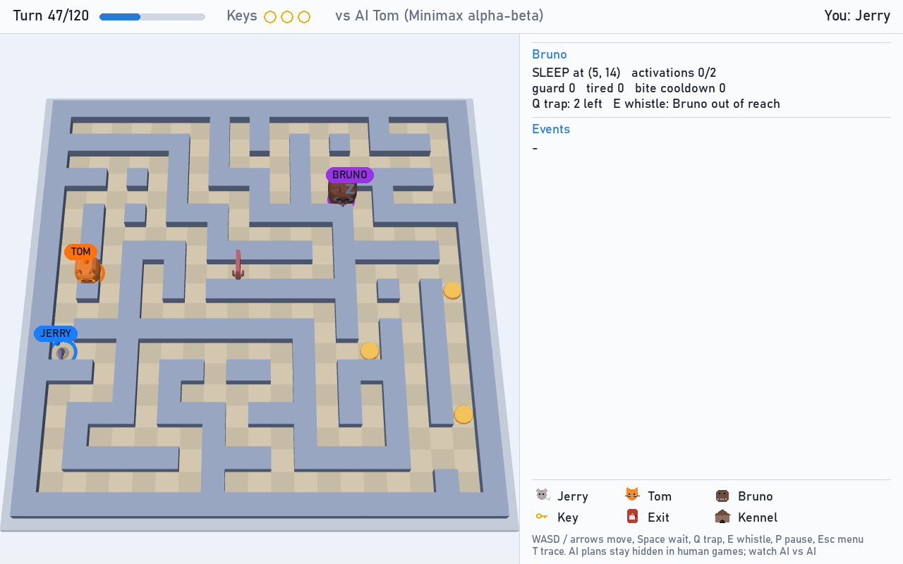
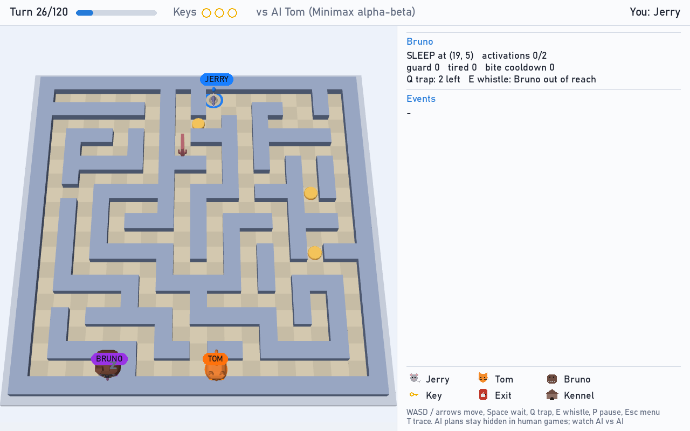
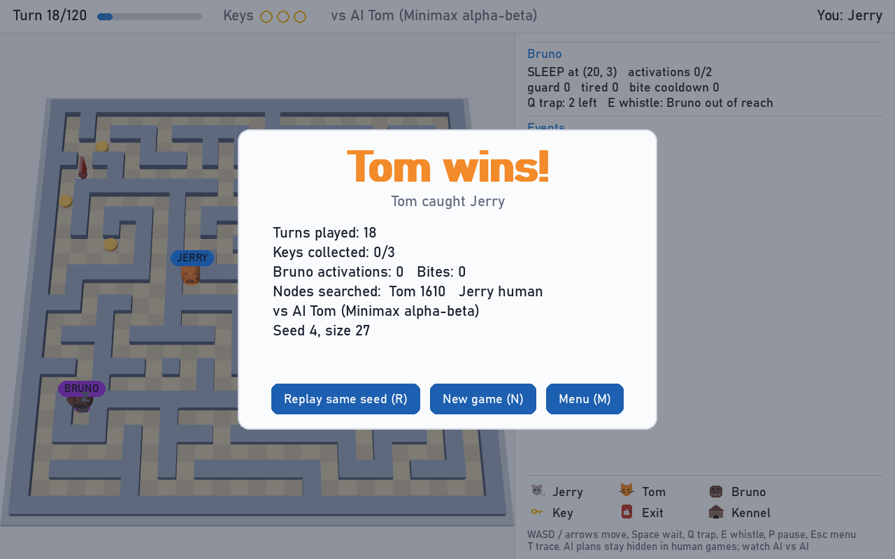

# Cheese Heist

A turn-based Tom & Jerry maze game built for the **CSE 3210 Artificial Intelligence Lab**. Jerry has to collect three golden keys and escape through the exit. Tom has to catch her before turn 120. Bruno, a sleeping bulldog, takes whichever side wakes him. Either character can be played by a human or by an AI, so the game is also a testbed for four classic AI techniques.

| AI technique | Where it is used | File |
|---|---|---|
| Graph search (BFS, bidirectional BFS) | Maze distances, reachability, fairness checks, path overlays | [search.py](search.py) |
| Minimax with alpha-beta pruning | Move choice every turn (iterative deepening, depth 4) | [minimax.py](minimax.py) |
| Monte Carlo Tree Search (information-set UCT) | Strategic target choice under hidden information | [mcts.py](mcts.py) |
| Mamdani fuzzy logic | Picks each AI's behaviour mode (HUNT, AMBUSH, SNEAK, DASH, ...) | [fuzzy.py](fuzzy.py) |

Tom and Jerry never use the same algorithm in one game. If Tom runs Minimax, Jerry runs MCTS, and the other way round.

The write-up is in [Cheese_Heist_Final_Report.pdf](Cheese_Heist_Final_Report.pdf), and the presentation slides are in `Cheese Heist AI Lab Final.pptx`.

## Screenshots

Human Jerry vs AI Tom (Minimax), 21x21 board with the 3D renderer:





End screen on a 27x27 board (seed 4):



Recorded games (download or open on GitHub):
[live gameplay](videos/tom_jerry_live_gameplay.mp4),
[Jerry escapes](videos/game1_seed10_jerry_escapes.mp4),
[Bruno bites Tom](videos/game2_seed4_bruno_bites.mp4),
[Tom captures Jerry](videos/game3_seed14_tom_captures.mp4).

## Quick start

Requires Python 3.10+ and an OpenGL 3.3 capable GPU or driver for the 3D view.

```bash
git clone https://github.com/Mutiur03/CSE3210_Artificial_Intelligence_Lab.git
cd CSE3210_Artificial_Intelligence_Lab
python -m venv .venv
.venv\Scripts\activate          # Windows; on Linux/macOS: source .venv/bin/activate
pip install -r requirements.txt
python main.py
```

The menu lets you play as Jerry, play as Tom, watch AI vs AI, open the algorithm demo, or read How to Play. F11 or Alt+Enter toggles full screen.

### Command line options

```
python main.py [--seed N] [--size {15,21,27,31}] [--no-bruno]
               [--tom {minimax,mcts}] [--demo] [--trace]
```

| Option | Meaning |
|---|---|
| `--seed N` | Maze and AI seed. Same seed, same maze, same game (default 1). |
| `--size` | Board size in cells (default 21). |
| `--no-bruno` | Play without the dog. |
| `--tom minimax\|mcts` | Tom's algorithm. Jerry's AI uses the other one. |
| `--demo` | Open the algorithm demo screen directly. |
| `--trace` | Save every AI decision trace to `results/traces/`. |
| `--screenshot FILE --auto N` | Headless: play N random rounds, save a PNG, exit. |

## How to play

1. Jerry (grey mouse) collects all **3 golden keys**.
2. The third key opens the exit (the red door turns green) and tells Tom where it is.
3. Jerry wins by walking onto the open exit. Tom wins by catching Jerry, or when **turn 120** passes.
4. Both characters see only **5 steps** along corridors (fog of war). Tom can smell the keys, but not Jerry.
5. Jerry can step on the **kennel** to wake Bruno, twice per game. Bruno guards Jerry and bites Tom, which stuns Tom for 3 turns.
6. From turn 50, Tom sniffs out Jerry's position every 8 turns, so hiding does not work for long.

### Controls

| Key | Action |
|---|---|
| WASD / arrow keys | Move |
| Space | Wait |
| Q | Set a mouse trap (human Jerry, 2 per game; stuns Tom for 2 turns) |
| E | Whistle: send Bruno back to guard Jerry (8-turn cooldown) |
| P | Pause |
| Esc | Menu |

Extra keys in **Watch AI vs AI**:

| Key | Action |
|---|---|
| Tab | Show the planned path |
| E | Show explored cells |
| N | Single step |
| + / - | Change speed (1x to 16x) |
| T | Save AI traces |

In the main menu, Up/Down select, Left/Right change the seed, size, Bruno toggle and Tom's algorithm, and Enter activates.

Human games hide the AI's plans on purpose. Use the AI vs AI mode to see its reasoning in the side panel (current fuzzy mode, search statistics, node counts).

## How the AI works

Agents receive only an `Observation`, never the full game state. Each keeps its own memory of where the opponent was last seen. Every turn is a two-stage pipeline.

1. **Fuzzy controller** ([fuzzy.py](fuzzy.py)) turns the situation into a behaviour mode.
   - Tom's inputs are distance to Jerry, age of the last sighting, and Bruno's threat. His modes are `HUNT`, `AMBUSH`, `SWEEP` and `RETREAT`.
   - Jerry's inputs are danger, keys left, and whether Bruno is ready. Her modes are `SNEAK`, `EVADE`, `RUN_FOR_BRUNO` and `DASH`.
   - The engine uses triangular and trapezoid membership functions, min for AND and implication, max for aggregation, and centroid defuzzification. Rules are plain data tables.
2. **Search** uses that mode to choose the move.
   - **Minimax** ([minimax.py](minimax.py)): alpha-beta with iterative deepening, a node cap and a time safety net. The mode rescales the evaluation terms through `MODE_SCALE` in [config.py](config.py). Tom is MAX, Jerry is MIN.
   - **MCTS** ([mcts.py](mcts.py)): picks a *target cell*, and the agent walks there. Because the opponent's position is hidden, each iteration samples a possible position first (determinization). Then it runs UCB1 selection, expansion, a short scripted playout and backpropagation.

All randomness uses the game seed, so a game replays identically.

## Game and maze design

- **Maze** ([maze.py](maze.py)): a DFS recursive-backtracker, plus about 8% of interior walls removed to create loops. Keys, exit, kennel and starts are placed under distance rules: Jerry and Tom start at least 16 steps apart, and keys are at least 6 steps apart. A fairness check requires that a best-case start, three keys, exit walk fits in 70 turns, so every generated maze is winnable.
- **Rules** ([game.py](game.py)): pure game logic with no pygame. Round order is Jerry acts, Tom acts (skipped while stunned), Bruno acts, timers tick.
- **Bruno** is a finite-state machine: `SLEEP`, `GUARD`, `CHASE_CAT`, `TIRED`. He guards for 12 turns, then gets tired for 20.
- **Fog of war**: `make_observation` builds what a character may know. The `AI_FULL_INFO` flag in [config.py](config.py) is on by default, so both AIs see both characters everywhere. Turn it off to make the AIs play under the same fog as a human.

## Project layout

```
main.py        entry point: menu, game loop, input, sessions
game.py        rules, state, Bruno FSM, observations, win checks
maze.py        maze generation and validation
search.py      BFS, bidirectional BFS, dead-end and core-cell helpers
minimax.py     minimax and alpha-beta, iterative deepening
mcts.py        information-set UCT
fuzzy.py       Mamdani fuzzy engine and the two controllers
agents.py      AI agents: fuzzy mode + algorithm, memory, loop breaking
demo.py        algorithm demo screen (inspect Minimax / MCTS on a custom board)
ui.py          2D drawing: HUD, panels, menu, help, end screen
render3d.py    3D board renderer (ModernGL, drawn offscreen into pygame)
config.py      every constant: rules, AI weights, window, palette
assets/        CC0 glTF models (see assets/LICENSES.md)
docs/screens/  gameplay screenshots used in this README
videos/        recorded example games
```

Tuning the game or the AI almost always means editing [config.py](config.py): turn limit, vision radius, Bruno timers, search depth, MCTS iterations, evaluation weights.

## Algorithm demo

`python main.py --demo` (or the **Algorithm Demo** menu item) shows each algorithm on a board you control. Press `1` for Minimax alpha-beta or `2` for MCTS. Left-click sets Jerry's cell, right-click sets Tom's cell, and Up/Down change the MCTS sighting age. The numbers shown come from the same functions the agents call.

## Troubleshooting

- **3D view does not start or looks wrong**: the renderer needs OpenGL 3.3. Update your graphics driver. A missing model file falls back to a simple primitive shape, so the game still runs.
- **Fonts look different**: the UI picks the first installed font of Bahnschrift, Segoe UI or Arial, and falls back to the pygame default.

## Credits

3D models are CC0 by [Kenney](https://kenney.nl) and [Quaternius](https://quaternius.com). Full list with sources in [assets/LICENSES.md](assets/LICENSES.md). Built with [pygame](https://www.pygame.org), [ModernGL](https://github.com/moderngl/moderngl), [trimesh](https://trimesh.org) and NumPy.
